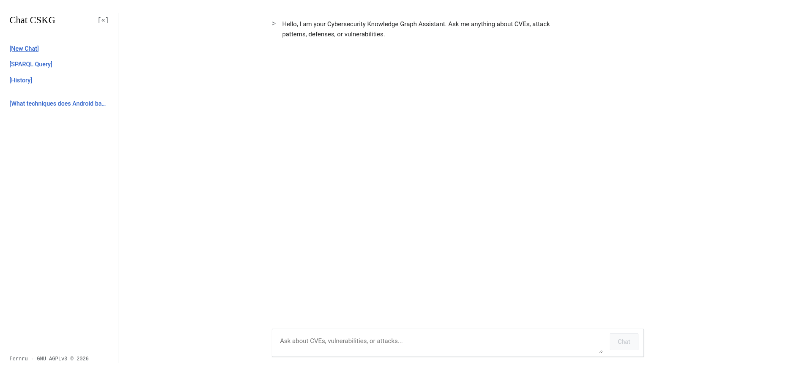
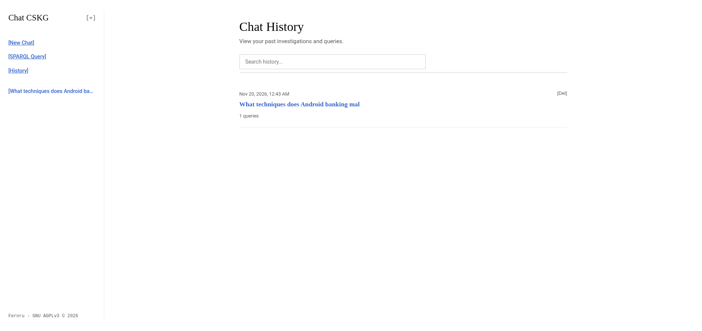
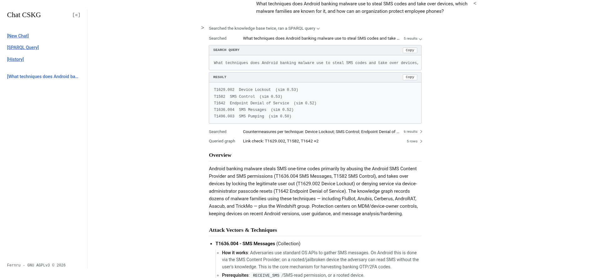
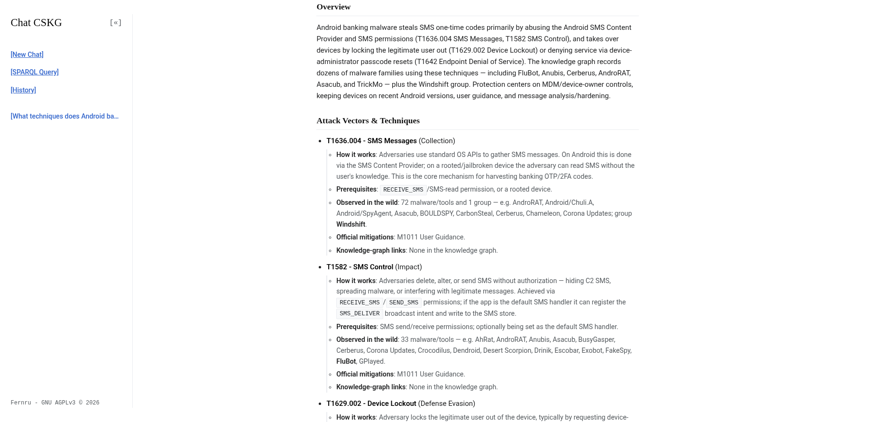
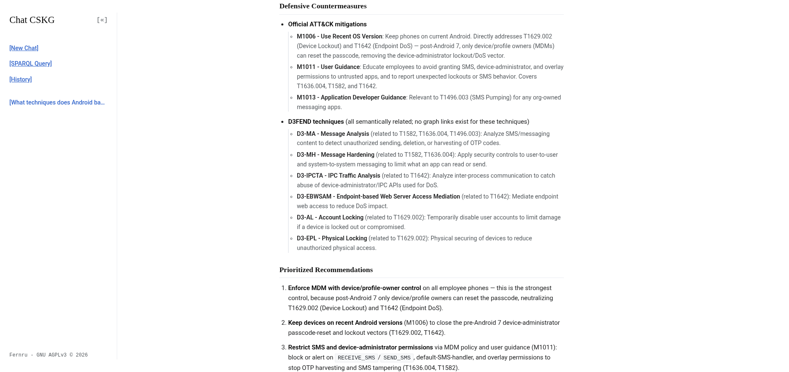

# Cybersecurity Knowledge Graph (CSKG) Pipeline

This project implements an ETL pipeline to fetch, parse, link, validate, and query cybersecurity data (CVE, CPE, CWE, CAPEC, ATT&CK techniques, mitigations, software and groups, D3FEND, EPSS, CISA KEV) using the SEPSES ontology. On top of it sit a hybrid (vector + knowledge graph) retriever and a natural-language chat agent (Groq) that answers security questions with grounded, cited results.


## Installation

### Prerequisites

- Python 3.10+ (the code uses `X | None` type syntax)
- Docker & Docker Compose (for the SPARQL Endpoint)
- `pip` or `pipenv`

### 1. Clone the repository

```bash
git clone https://github.com/feinru/cskg-agentic   
cd cskg-agentic
```

### 2. Configuration

Configuration is primarily handled through environment variables and `.env` files.

### Environment Variables

| Variable | Description | Required / Optional | Default Value |
| --- | --- | --- | --- |
| `GROQ_API_KEY` | Groq access for the chat agent ([get a key](https://console.groq.com/keys)). | **Required** | None |
| `GROQ_MODEL` | Groq model used by the chat agent (must support tool use), e.g. `openai/gpt-oss-120b`. | Optional | `qwen/qwen3.8-27b` |
| `GROQ_REASONING_EFFORT` | Model reasoning: Qwen `none`/`default`, gpt-oss `low`/`medium`/`high`. Reasoning tokens count toward the per-minute budget. | Optional | `none` (Qwen), `low` (gpt-oss) |
| `GROQ_MAX_TOKENS` | Answer length cap (counted against Groq's tokens-per-minute limit up front). | Optional | `2200` |
| `NVD_API_KEY` | Optional key to bypass NVD rate limits (fetches faster). | Optional | None |
| `NVD_MAX_DEMO` | Cap CVE/CPE (and EPSS) fetches to N records for quick demos (`0` = everything). Ignored by incremental syncs. | Optional | `0` |
| `NVD_DELTA_DAYS` | With an existing cache but no sync record, only fetch records modified in the last N days. | Optional | `0` |
| `VIRTUOSO_HOST` | Host address of the Virtuoso SPARQL endpoint. | Optional | `localhost` (or `virtuoso` in Compose) |
| `VIRTUOSO_CONTAINER`| Name of the running Virtuoso Docker container. | Optional | `cskg-sparql` |
| `SPARQL_ENDPOINT` | SPARQL endpoint used by the web app, retriever and evaluation. | Optional | `http://localhost:8890/sparql` |
| `VECTOR_ENDPOINT` | Hybrid retrieval endpoint used by the chat agent. | Optional | `http://localhost:8000/hybrid` |
| `SPARQL_PROXY_TIMEOUT` | Seconds the retriever waits for Virtuoso when proxying `/sparql`. | Optional | `120` |

> Don't set `SPARQL_ENDPOINT` to the retriever (`:8000`) in `.env`. The retriever reads `.env` as well and would proxy to itself.

Rename `.env.example` to `.env` in the project root:
```bash
cp .env.example .env
```

> **Add your `GROQ_API_KEY` to the new `.env` file.** The chat UI needs it to write answers. Groq's free tier allows about 30 requests/minute and 1,000/day, but only ~8K tokens/minute: one detailed answer uses ~6.8K, so ask about one big question per minute (follow-ups may briefly wait; the UI shows it).

## Quick Start with Docker

The easiest way to build, run, and query the entire CSKG pipeline and web UI is using Docker Compose.

### 1. Build and Start Services
This starts Virtuoso, the pipeline container, the retriever service and the Next.js web application. The pipeline container automatically runs the sequential fetch-parse-link-validate-load-index cycle (`./run.sh all`):
```bash
docker compose up --build -d
```

### 2. Verify Services
Once the pipeline container output shows completion, you can access your services:
- **Agentic Web UI (Chat)**: `http://localhost:3000`
- **Retriever (SPARQL proxy + hybrid search)**: `http://localhost:8000/health`
- **SPARQL Endpoint**: `http://localhost:8890/sparql`
- **Web Admin UI**: `http://localhost:8890/conductor`

### 3. Stop Services
When you are done, you can safely shut down all the background containers without losing your database data by running:
```bash
docker compose down
```

## How to Run the Pipeline (Local/Manual)

The pipeline is modular. `run.sh` runs each step from the repository root (it uses `.venv/bin/python` when present):

```bash
./run.sh [all|fetch|parse|link|validate|load|vector|eval|test]
```

### 1. Install Dependencies
```bash
pip install -r requirements.txt
```

### 2. Fetch, parse, link, validate
```bash
./run.sh fetch
./run.sh parse
./run.sh link
./run.sh validate
```

The NVD fetcher syncs incrementally. After one complete, uncapped fetch it records a timestamp in `modules/fetcher/cache/nvd_sync.json`, and later runs only download records modified since then (at most 120 days back). An interrupted incremental run resumes the same time window the next time it runs. Delete `nvd_sync.json` to force a full re-fetch.

### 3. SPARQL Endpoint
Start Virtuoso from the root `docker-compose.yml`, then load the TTL files and ontology:
```bash
docker compose up -d virtuoso
./run.sh load
python sparql/verify.py
```

### 4. Vector Index and Retriever
```bash
./run.sh vector
python -m modules.vector.service
```
Run the web app with `cd web && npm install && npm run dev`.

### 5. Tests and Evaluation
```bash
./run.sh test
./run.sh eval
```

The benchmark (`eval/dataset.json`, 1,000 questions in four categories) compares pure vector search, a pure SPARQL lookup, and the production hybrid retriever (`modules/vector/hybrid.retrieve_hybrid`). Scoring is strict:
- IDs must match exactly.
- *Hit rate* only counts expected entities the question doesn't already name.
- *Recall* covers all expected entities.
- A negative control passes only if the method returns nothing without an error.
- SPARQL failures count as misses.

Results, including a per-category breakdown, are written to `eval/results.json`.

## How the Chat Agent Works

For every question, the web app (`web/app/api/chat/`) streams its progress to the browser and runs these steps:

1. **Server-side retrieval (`retrieval.ts`)**, run in code so a small model can't skip it:
   - a hybrid search of the knowledge base with the question;
   - D3FEND countermeasures searched per technique found (by technique name; analytic `D3A-` methods excluded);
   - one **link check** query covering every technique found, returning per technique: description, official ATT&CK mitigations, D3FEND links (direct, and via the same-name Enterprise technique for Mobile/ICS), CAPEC/CWE links, and the malware/tools and groups observed using it.

   A short follow-up with nothing to search for (e.g. "are those it?") re-runs the retrieval for the previous question.
2. **The model writes the report** from those results (Overview, techniques, defensive countermeasures, prioritized recommendations). It can still call `search_security_vectors` or `execute_sparql_query` for extra detail; model-written SPARQL gets missing prefixes added automatically, and Virtuoso's error messages are passed back.
3. **Safeguards:** if the model repeats a failed tool call, calls an unknown tool, or hits the step limit, the server writes the answer from the results gathered so far. Each model call is kept within Groq's per-minute token budget (older turns are dropped first), and per-minute rate limits are waited out automatically.
4. **Grounding check (`grounding.ts`):** every CVE, CWE, CAPEC, ATT&CK (T/M/S/G) and D3FEND ID in the answer must appear in a tool result, the question or an earlier answer; others are flagged as unverified under the answer.

The UI shows these steps live, then collapses them into a "Thinking process" panel above the answer, with each query and result copyable.

## Expected Outputs

- **Fetcher Module:** Raw cybersecurity data files stored in `modules/fetcher/cache/`.
- **Parser Module:** Parsed Turtle (`.ttl`) files mapped to SEPSES ontology.
- **Linking Module:** Linked Turtle files containing relationship triples, saved in `modules/linking/output/`.
- **Validation Module:** Validation reports summarizing triple counts, subjects, errors, and warnings.
- **SPARQL Endpoint:** A fully queryable Knowledge Graph at `http://localhost:8890/sparql` with named graphs such as `http://w3id.org/sepses/graph/cve`.
- **Vector Index:** A ChromaDB collection of CVE, CWE, CAPEC, ATT&CK and D3FEND entities in `modules/vector/db/`.
- **Retriever Service:** `http://localhost:8000` with a SPARQL proxy plus graph-augmented hybrid search.
- **Agentic Web UI:** A Next.js frontend at `http://localhost:3000` with a LangChain/LangGraph agent on Groq: server-side retrieval, a live process panel, grounded reports, and a SPARQL query page with presets.


## Security Use Cases
1. **Vulnerability Attack Chain Analysis** (`CVE` -> `CWE` -> `CAPEC` -> `ATT&CK`)
2. **Exploited Vulnerability Prioritization** (`CISA KEV` -> `ICSA` -> `CVE`)
3. **ATT&CK Technique Coverage Mapping** (`CAPEC` -> `ATT&CK`)
4. **Countermeasure Recommendation** (`CVE` -> `ATT&CK` -> `D3FEND`, materialized as `cve2attck` and `cve2d3fend`)
5. **Threat Context per Technique** (ATT&CK mitigations, and the malware, tools and groups observed using each technique: `mitigation2attck`, `software2attck`, `group2attck`)
6. **Mobile/ICS Countermeasures via Enterprise Twins** (Mobile/ICS technique -> same-name Enterprise technique -> D3FEND: `twin2attck`)

## Known Limitations

- **Performance Constraints:** Loading very large datasets (like the full NVD dataset) into Virtuoso locally may consume significant RAM and take a long time.
- **Missing Triples:** The validation agent might flag missing mandatory triples if the upstream data source (e.g., MITRE or NVD) has incomplete entries.
- **Sequential Dependency:** Steps run in order. If the fetcher fails or updates partial data, downstream steps must be re-run. `cve2attck` depends on `cwe2capec` and `capec2attck`, and `cve2d3fend` depends on `cve2attck` and `d3fend2attck`.
- **Stale Data (non-NVD sources):** MITRE, D3FEND, EPSS and ICSA data are cached and only refreshed when the upstream version changes. Clear `modules/fetcher/cache/` to force a refresh.
- **Demo Mode:** Setting `NVD_MAX_DEMO` caps CVE/CPE fetches. This causes many errors in `icsa2cve` and `cve2cpe` because most referenced CVEs are missing. A capped run never records a sync timestamp, so removing the cap later triggers a full fetch (~350K CVEs, about 2–4 hours with an NVD API key).
- **Transitive CVE→ATT&CK links:** `cve2attck` derives techniques through CWE → CAPEC → ATT&CK (plus explicit ATT&CK references). Generic CWEs such as CWE-200 map to up to ~26 techniques, so these links indicate *possible* techniques, not observed ones.
- **Cross-Framework Coverage:** Upstream CAPEC and D3FEND map mainly to Enterprise ATT&CK, while ATT&CK's own mitigations and observed-use data cover all three matrices:

  | Techniques with… | Enterprise (706) | Mobile (125) | ICS (104) |
  |---|---|---|---|
  | CAPEC link | 179 | 1 | 0 |
  | D3FEND countermeasure link | 311 | 0 | 56 |
  | D3FEND link, direct or via same-name Enterprise twin | 311 | 44 | 60 |
  | Official ATT&CK mitigation (M####) | 595 | 89 | 103 |
  | Recorded use by malware/tools or groups | 609 | 112 | 87 |

  For mobile threats, ATT&CK mitigations are the authoritative prevention guidance. D3FEND countermeasures reach Mobile/ICS techniques through `twin2attck`, or otherwise by semantic similarity only.
- **Enterprise Twins Are a Naming Heuristic:** `twin2attck` links a Mobile/ICS technique to the Enterprise technique with the identical name (115 links). MITRE publishes no such relationship, so the agent labels these countermeasures "via Enterprise twin". Only exact names are used: inheriting a parent's sub-technique links was rejected because it pulls in unrelated defences (e.g. network-flood controls for mobile passcode-reset denial of service).
- **Answer Grounding:** The chat agent is told to cite only tool results, and the server also checks every CVE/CWE/CAPEC/ATT&CK (T/M/S/G)/D3FEND ID in the answer against the tool outputs. IDs the tools never returned are flagged as unverified under the answer. The check covers IDs, not relationships between them.
- **Semantic Search Scope:** ATT&CK mitigations, software and groups are in the graph but not in the vector index, so questions naming a specific malware or group (e.g. "what does BRATA do?") rely on the model writing SPARQL.
- **Groq Free Tier:** ~8K tokens/minute per model. The agent budgets each call to fit, but back-to-back questions wait for the next minute's allowance.
- **Partial Vector Index:** Only `DEFAULT_CVE_INDEX_LIMIT` (5,000) CVEs are embedded: all known-exploited CVEs (CISA KEV) first, then the most recently published. Other CVEs are reachable through exact-ID SPARQL lookups, but not through semantic search. `./run.sh vector` always rebuilds the index from scratch.
- **Sampled Validation:** For TTL files over 15 MB, SHACL validation only checks the first 25,000 lines. The compliance score is computed over the triples actually validated.
- **CVSS Scores:** `cve:baseScore` / `cve:severity` use NVD's primary assessment when available, in the order v3.1, v3.0, v4.0, v2. Check `cve:vectorString` (for example `CVSS:4.0/...`) to see which version a score comes from.
- **CPE URIs:** CPE resource URIs are built by stripping `:` and `/` from the CPE name, so 65 of 1.86M CPE names that differ only by escaped characters share a URI.
- **Evaluation Bias:** The hybrid retriever's no-match threshold (`NO_MATCH_SIMILARITY = 0.38`) was tuned on the same benchmark it is scored on, so negative-control results are optimistic. Only retrieval is benchmarked; the end-to-end chat answers are not.

## Showcase

The project features a Web UI built with Next.js, allowing SOC analysts to query the Knowledge Graph using natural language.

<p align="center">
  
  
</p>

<p align="center">
  
</p>

<p align="center">
  
  
</p>